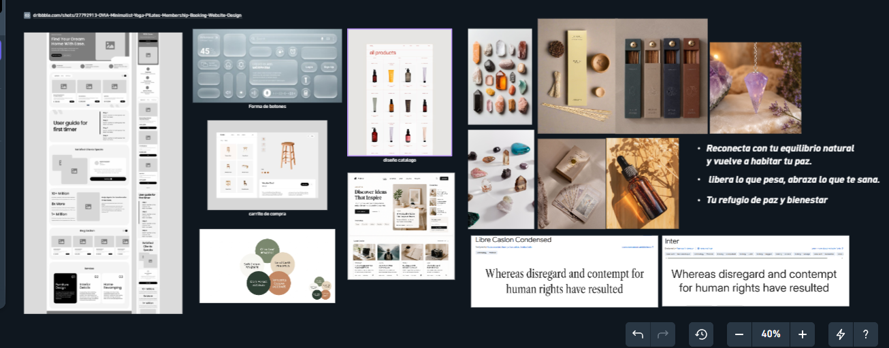

# Moodboard — Elysa

> Guía: [Moodboard](../evaluacion/guias/fase-2-specs/02-moodboard.md)

**Tablero en Whimsical:** [Pega aquí el enlace público de tu tablero en Whimsical]

## Palabras clave

Calma · Sanación · Equilibrio · Calidez · Conexión espiritual

## Qué sensación buscamos

Buscamos que la interfaz de Elysa se perciba como un refugio de paz, autocuidado y bienestar integral: tonos tierra y olivas botánicos, luz cálida envolvente y la presencia sutil de elementos terapéuticos reales (cuarzos de Tameana, péndulo amatista, esencias de Bach y cartas de Tarot). Valentina llega a la web al final de su jornada buscando aliviar la sobrecarga mental y el estrés laboral; este ambiente visual limpio, orgánico y transparente le inspira confianza inmediata, serenidad y contención para regalarse un momento de reconexión energética.
